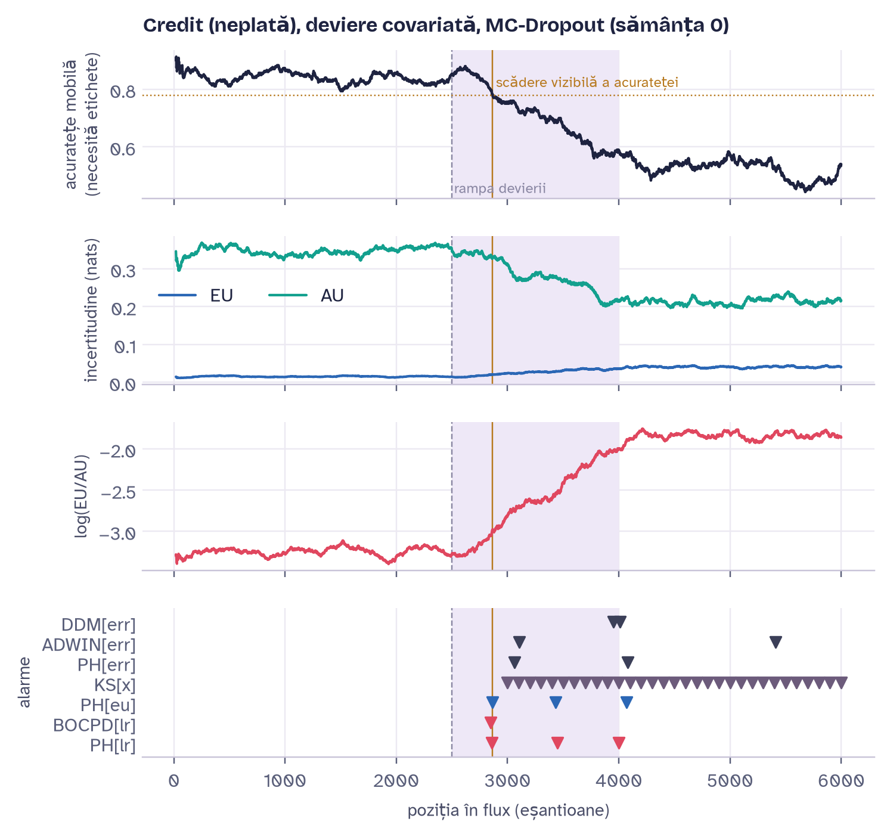
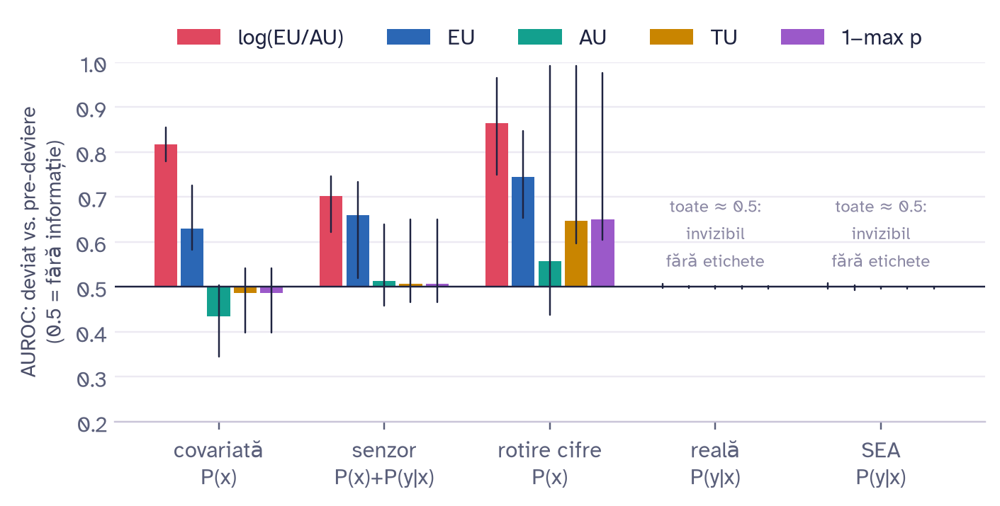
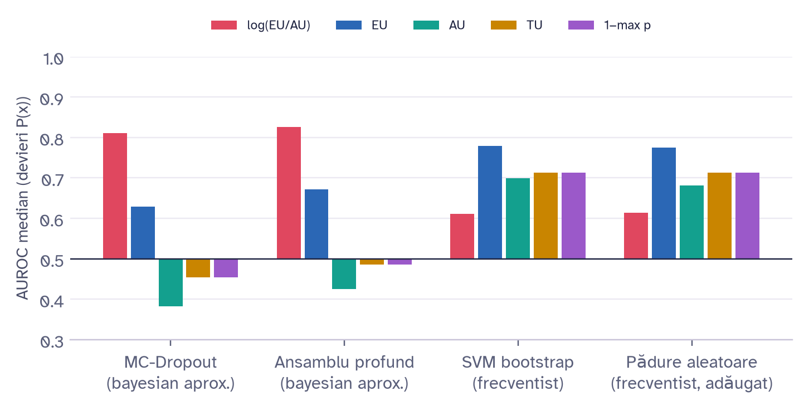
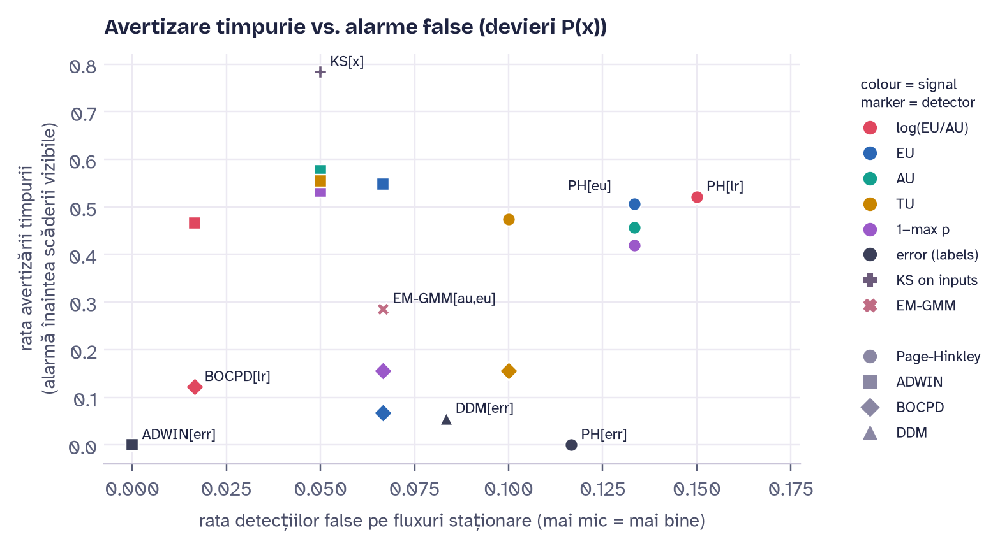
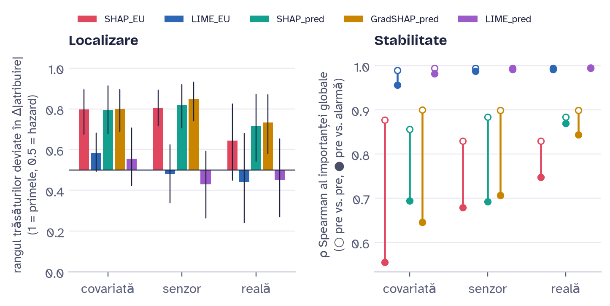

::: {.only-latex}
```{=latex}
\begin{center}
{\fontsize{14}{16}\selectfont\bfseries DESCOMPUNEREA BAYESIANĂ A INCERTITUDINII PENTRU AVERTIZAREA TIMPURIE A DEVIERII CONCEPTUALE, VALIDATĂ PRIN XAI\par}
\vspace{12pt}
{\bfseries Prenumele NUMELE\textsuperscript{1*}\par}
\vspace{10pt}
{\fontsize{10}{12}\selectfont\itshape \textsuperscript{1}Departamentul [denumirea], grupa [grupa], Facultatea [denumirea], Universitatea Tehnică a Moldovei, Chișinău, Republica Moldova\par}
\vspace{10pt}
{\fontsize{10}{12}\selectfont *Autorul corespondent: Prenumele Numele, [e-mail]\par}
\vspace{10pt}
{\fontsize{10}{12}\selectfont\bfseries Îndrumătorul/coordonatorul științific \normalsize Prenumele NUMELE\fontsize{10}{12}\selectfont, \mdseries [titlul științific, afilierea]\par}
\end{center}
\vspace{6pt}
```
:::

::: {.only-docx}
```{=openxml}
<w:p><w:pPr><w:spacing w:before="120"/><w:jc w:val="center"/><w:rPr><w:b/><w:bCs/><w:sz w:val="28"/><w:szCs w:val="28"/><w:lang w:val="ro-RO"/></w:rPr></w:pPr><w:r><w:rPr><w:b/><w:sz w:val="28"/><w:szCs w:val="28"/><w:lang w:val="ro-RO"/></w:rPr><w:t>DESCOMPUNEREA BAYESIANĂ A INCERTITUDINII PENTRU AVERTIZAREA TIMPURIE A DEVIERII CONCEPTUALE, VALIDATĂ PRIN XAI</w:t></w:r></w:p>
<w:p><w:pPr><w:pStyle w:val="NoSpacing"/><w:jc w:val="center"/></w:pPr></w:p>
<w:p><w:pPr><w:pStyle w:val="NoSpacing"/><w:jc w:val="center"/><w:rPr><w:rFonts w:ascii="Times New Roman" w:hAnsi="Times New Roman"/><w:b/><w:bCs/><w:sz w:val="24"/><w:szCs w:val="24"/><w:lang w:val="ro-RO"/></w:rPr></w:pPr><w:r><w:rPr><w:rFonts w:ascii="Times New Roman" w:hAnsi="Times New Roman"/><w:b/><w:bCs/><w:sz w:val="24"/><w:szCs w:val="24"/><w:lang w:val="ro-RO"/></w:rPr><w:t xml:space="preserve">Prenumele NUMELE</w:t></w:r><w:r><w:rPr><w:rFonts w:ascii="Times New Roman" w:hAnsi="Times New Roman"/><w:b/><w:bCs/><w:sz w:val="24"/><w:szCs w:val="24"/><w:vertAlign w:val="superscript"/><w:lang w:val="ro-RO"/></w:rPr><w:t>1*</w:t></w:r></w:p>
<w:p><w:pPr><w:pStyle w:val="NoSpacing"/><w:jc w:val="center"/></w:pPr></w:p>
<w:p><w:pPr><w:jc w:val="center"/><w:rPr><w:i/><w:sz w:val="20"/><w:szCs w:val="20"/><w:lang w:val="ro-RO"/></w:rPr></w:pPr><w:r><w:rPr><w:i/><w:sz w:val="20"/><w:szCs w:val="20"/><w:vertAlign w:val="superscript"/><w:lang w:val="ro-RO"/></w:rPr><w:t>1</w:t></w:r><w:r><w:rPr><w:i/><w:sz w:val="20"/><w:szCs w:val="20"/><w:lang w:val="ro-RO"/></w:rPr><w:t>Departamentul [denumirea], grupa [grupa], Facultatea [denumirea], Universitatea Tehnică a Moldovei, Chișinău, Republica Moldova</w:t></w:r></w:p>
<w:p><w:pPr><w:jc w:val="center"/></w:pPr></w:p>
<w:p><w:pPr><w:pStyle w:val="ListParagraph"/><w:shd w:val="clear" w:color="auto" w:fill="FFFFFF"/><w:ind w:left="374"/><w:jc w:val="center"/><w:rPr><w:sz w:val="20"/><w:szCs w:val="20"/><w:lang w:val="ro-RO"/></w:rPr></w:pPr><w:r><w:rPr><w:sz w:val="20"/><w:szCs w:val="20"/><w:lang w:val="ro-RO"/></w:rPr><w:t>*Autorul corespondent: Prenumele Numele, [e-mail]</w:t></w:r></w:p>
<w:p><w:pPr><w:pStyle w:val="ListParagraph"/><w:shd w:val="clear" w:color="auto" w:fill="FFFFFF"/><w:ind w:left="374"/><w:jc w:val="center"/></w:pPr></w:p>
<w:p><w:pPr><w:pStyle w:val="ListParagraph"/><w:shd w:val="clear" w:color="auto" w:fill="FFFFFF"/><w:ind w:left="374"/><w:jc w:val="center"/><w:rPr><w:b/><w:sz w:val="20"/><w:szCs w:val="20"/><w:lang w:val="ro-RO"/></w:rPr></w:pPr><w:r><w:rPr><w:b/><w:sz w:val="20"/><w:szCs w:val="20"/><w:lang w:val="ro-RO"/></w:rPr><w:t xml:space="preserve">Îndrumătorul/coordonatorul științific </w:t></w:r><w:r><w:rPr><w:b/><w:bCs/><w:lang w:val="ro-RO"/></w:rPr><w:t>Prenumele NUMELE</w:t></w:r><w:r><w:rPr><w:b/><w:sz w:val="20"/><w:szCs w:val="20"/><w:lang w:val="ro-RO"/></w:rPr><w:t xml:space="preserve">, </w:t></w:r><w:r><w:rPr><w:sz w:val="20"/><w:szCs w:val="20"/><w:lang w:val="ro-RO"/></w:rPr><w:t>[titlul științific, afilierea]</w:t></w:r></w:p>
<w:p><w:pPr><w:tabs><w:tab w:val="left" w:pos="2268"/></w:tabs><w:ind w:right="18"/><w:jc w:val="both"/></w:pPr></w:p>
```
:::

::: {custom-style="Rezumat"}
***Rezumat.*** Detectoarele clasice de deviere conceptuală urmăresc rata de eroare a modelului, deci au nevoie de etichete și reacționează abia după ce acuratețea a scăzut. Lucrarea testează dacă incertitudinea modelului, calculată numai din intrări, poate da o alarmă mai devreme și ce componentă a ei este utilă. Entropia predictivă a unei rețele MC-Dropout, a unui ansamblu de rețele și a două ansambluri frecventiste (SVM și pădure aleatoare) este separată în incertitudine aleatorică și epistemică, iar raportul lor logaritmic este propus ca semnal de monitorizare. Pe 225 de fluxuri construite din date reale, cu moment de deviere cunoscut, și pe fluxul natural Elec2, cinci ipoteze stabilite în prealabil au fost testate statistic. Raportul separă cel mai bine datele deviate pentru rețelele neuronale (AUROC 0.80 față de 0.67), dar nu și pentru modelele frecventiste. Alarma fără etichete vine mai devreme decât detectoarele bazate pe eroare, însă precede scăderea vizibilă a acurateței doar în 51 % din cazuri. Devierea relației dintre intrări și etichete rămâne invizibilă fără etichete, iar SHAP, spre deosebire de LIME, indică trăsăturile care au deviat. Codul și datele permit reproducerea integrală.
:::

::: {custom-style="CuvinteCheie"}
***Cuvinte cheie:*** *informație mutuală, monte carlo dropout, monitorizare fără etichete, valori shapley, inferență statistică.*
:::

# Introducere

Un model de învățare automată este antrenat pe date istorice și apoi folosit pe date noi, a căror distribuție $P_t(x,y)=P_t(x)\,P_t(y\mid x)$ se schimbă în timp. Fenomenul se numește deviere conceptuală (*concept drift*) [@gama2014; @lu2019]. Detectoarele uzuale, DDM [@gama2004], ADWIN [@bifet2007] și Page-Hinkley (PH) [@page1954], urmăresc rata de eroare. Ele au nevoie de eticheta reală a fiecărei predicții, care în creditare sau în detectarea fraudei sosește după luni, și reacționează după ce acuratețea a scăzut.

O alternativă este incertitudinea modelului însuși. Baier et al. [@baier2023] monitorizează incertitudinea *totală* a unei rețele MC-Dropout. Teoria bayesiană permite însă separarea incertitudinii în componenta aleatorică (AU, zgomotul din date) și cea epistemică (EU, ignoranța modelului) [@kendall2017; @depeweg2018; @hullermeier2021]. Contribuțiile lucrării sunt: (i) raportul $\log(EU/AU)$ ca semnal de monitorizare, comparat direct cu componentele sale; (ii) demonstrarea limitei oricărei detecții fără etichete; (iii) validarea alarmelor prin explicarea funcției $EU(x)$ cu SHAP și LIME; (iv) comparația dintre incertitudinea bayesiană și cea frecventistă; (v) fluxuri semi-sintetice cu moment și trăsături de deviere cunoscute.

Ipotezele, fixate înainte de experimente, sunt: **H1** – sub devieri ale lui $P(x)$, alarma pe $\log(EU/AU)$ precede scăderea vizibilă a acurateței; **H2** – raportul separă datele deviate mai bine decât EU, AU, entropia totală (TU) și $1-\max p$; **H3** – sub deviere pură a lui $P(y\mid x)$ niciun semnal de incertitudine nu conține informație; **H4** – atribuirile SHAP/LIME ale lui EU indică trăsăturile deviate; **H5** – incertitudinea bayesiană și cea frecventistă se comportă diferit.

# Metodologie

## Modele și descompunerea incertitudinii

Antrenarea prin entropie încrucișată este o estimare de verosimilitate maximă, iar penalizarea L2 corespunde unei distribuții a priori gaussiene (estimare MAP). Distribuția a posteriori a ponderilor este aproximată prin MC-Dropout cu $T=30$ măști fixe [@gal2016] și printr-un ansamblu de $M=5$ rețele [@lakshminarayanan2017]. Ca termen frecventist se folosesc 10 SVM-uri cu nucleu RBF antrenate pe eșantioane bootstrap. Ca analiză suplimentară, adăugată după studiul principal, se folosește o pădure aleatoare de 50 de arbori [@breiman2001], descompusă ca în [@shaker2020]. Pentru $S$ distribuții predictive eșantionate $p_s$, descompunerea [@depeweg2018] este dată de Ec. (1):

::: {.only-docx}
::: {custom-style="Ecuatie"}
`<w:r><w:tab/></w:r>`{=openxml}$\underbrace{H\Big[\frac{1}{S}\sum_{s} p_s\Big]}_{TU} = \underbrace{\frac{1}{S}\sum_{s} H[p_s]}_{AU} + \underbrace{I(y;\theta \mid x)}_{EU}$`<w:r><w:tab/><w:t>(1)</w:t></w:r>`{=openxml}
:::
:::

::: {.only-latex}
```{=latex}
\begin{equation}
\underbrace{H\Big[\frac{1}{S}\sum_{s} p_s\Big]}_{TU} = \underbrace{\frac{1}{S}\sum_{s} H[p_s]}_{AU} + \underbrace{I(y;\theta \mid x)}_{EU}
\end{equation}
```
:::

unde $H$ este entropia, iar $I$ este informația mutuală dintre etichetă și parametri. EU este mare când modelele eșantionate nu sunt de acord. Semnalul propus este dat de Ec. (2), cu $\varepsilon=10^{-4}$:

::: {.only-docx}
::: {custom-style="Ecuatie"}
`<w:r><w:tab/></w:r>`{=openxml}$LR(x)=\log\big(EU(x)+\varepsilon\big)-\log\big(AU(x)+\varepsilon\big)$`<w:r><w:tab/><w:t>(2)</w:t></w:r>`{=openxml}
:::
:::

::: {.only-latex}
```{=latex}
\begin{equation}
LR(x)=\log\big(EU(x)+\varepsilon\big)-\log\big(AU(x)+\varepsilon\big)
\end{equation}
```
:::

Dacă $P_t(x)$ rămâne constant, orice funcție $g(x)$, inclusiv EU, AU și LR, are aceeași distribuție înainte și după deviere, deci un detector bazat pe ea nu poate depăși nivelul de semnificație. Această limită este testată prin H3.

## Date și fluxuri cu deviere cunoscută

Seturile de date sunt prezentate în Tab. 1. Toate sunt publice, au licențe care permit cercetarea și sunt verificate prin amprentă SHA-256 la fiecare rulare.

::: {.only-docx}
```{=openxml}
<w:p><w:pPr><w:pStyle w:val="NoSpacing"/><w:jc w:val="right"/></w:pPr><w:r><w:rPr><w:rFonts w:ascii="Times New Roman" w:hAnsi="Times New Roman"/><w:i/><w:lang w:val="ro-RO"/></w:rPr><w:t>Tabelul 1</w:t></w:r></w:p>
<w:p><w:pPr><w:pStyle w:val="NoSpacing"/><w:keepNext/><w:jc w:val="center"/></w:pPr><w:r><w:rPr><w:rFonts w:ascii="Times New Roman" w:hAnsi="Times New Roman"/><w:b/><w:lang w:val="ro-RO"/></w:rPr><w:t>Seturile de date utilizate</w:t></w:r></w:p>
```

| **Set de date** | **Domeniu** | **Înregistrări × trăsături** | **Țintă (rata clasei pozitive)** | **Licență** |
|------------------------|--------------------|----------------|--------------------|--------------|
| Credit (Taiwan, 2005) [@yeh2009] | risc de credit | 30 000 × 23 | neplată (22.1 %) | CC BY 4.0 |
| Telco Customer Churn [@ibm2019] | clienți telecom | 7 043 × 19 | plecarea clientului (26.5 %) | Apache-2.0 |
| Elec2 [@harries1999] | piața energiei, flux natural | 45 312 × 6 | creșterea prețului (42.5 %) | liberă pentru cercetare |
| Cifre 8×8 (UCI) | imagini | 1 797 × 64 | 10 clase | CC BY 4.0 |
| SEA [@street2001] | sintetic | generat | binar | generat cu River [@montiel2021] |
:::

::: {.only-latex}
```{=latex}
\begin{flushright}\textit{\fontsize{11}{13}\selectfont Tabelul 1}\end{flushright}\vspace{-6pt}
\begin{center}{\fontsize{11}{13}\selectfont\bfseries Seturile de date utilizate}\end{center}\vspace{-6pt}
{\fontsize{10}{12}\selectfont
\begin{tabularx}{\textwidth}{|>{\raggedright\arraybackslash}X|>{\raggedright\arraybackslash}p{2.9cm}|>{\centering\arraybackslash}p{2.6cm}|>{\raggedright\arraybackslash}p{3.2cm}|>{\raggedright\arraybackslash}p{2.1cm}|}
\hline
\textbf{Set de date} & \textbf{Domeniu} & \textbf{Înregistrări × trăsături} & \textbf{Țintă (rata clasei pozitive)} & \textbf{Licență}\\\hline
Credit (Taiwan, 2005) [CITE:yeh2009] & risc de credit & 30 000 × 23 & neplată (22.1 \%) & CC BY 4.0\\\hline
Telco Customer Churn [CITE:ibm2019] & clienți telecom & 7 043 × 19 & plecarea clientului (26.5 \%) & Apache-2.0\\\hline
Elec2 [CITE:harries1999] & piața energiei, flux natural & 45 312 × 6 & creșterea prețului (42.5 \%) & liberă pentru cercetare\\\hline
Cifre 8×8 (UCI) & imagini & 1 797 × 64 & 10 clase & CC BY 4.0\\\hline
SEA [CITE:street2001] & sintetic & generat & binar & generat cu River [CITE:montiel2021]\\\hline
\end{tabularx}}
\vspace{6pt}
```
:::

Pentru a putea măsura avansul unei alarme, fiecare set real este transformat într-un flux: 3 000 de înregistrări pentru antrenare, 1 000 pentru calibrare și un flux de 6 000, în care devierea începe la înregistrarea 2 500 și crește liniar pe 1 500 de înregistrări. Au fost generate patru mecanisme: *covariată* (un segment nou de clienți, $P(x)$), *senzor* (două trăsături deplasate cu $2\sigma$), *reală* (etichete inversate cu probabilitatea 0.7 într-o regiune, $P(y\mid x)$) și *fără deviere* (pentru alarme false). Trăsăturile deviate sunt înregistrate. Datele nu conțin identificatori personali, iar singurele valori lipsă (0.16 % din coloana *TotalCharges* a setului Telco) au fost imputate cu mediana. Populația o constituie toate înregistrările unui set, iar eșantioanele de antrenare, calibrare și flux sunt extrase cu semințe fixe (0–4).

## Detectori, evaluare și inferență

Semnalele fără etichete sunt monitorizate cu PH, ADWIN, o detecție bayesiană online a punctelor de schimbare (BOCPD) [@adams2007] și un amestec gaussian estimat prin EM [@dempster1977], ultimele două implementate de autor, alături de testul Kolmogorov-Smirnov pe intrări [@rabanser2019]. Pragurile sunt calibrate astfel încât probabilitatea unei alarme false pe un flux staționar să fie cel mult 0.10. Scăderea vizibilă a acurateței este primul moment în care acuratețea pe ultimele 300 de înregistrări scade cu peste trei erori standard sub nivelul inițial. Atribuirile sunt calculate cu KernelSHAP [@lundberg2017], GradientSHAP și LIME [@ribeiro2016].

Înregistrările dintr-un flux nu sunt independente, de aceea unitatea de analiză este rularea. Au fost efectuate 225 de rulări (12 scenarii × 3 modele × 5 semințe, plus 45 de ablații), testate cu Wilcoxon și corecție Holm [@holm1979], echivalența cu hazardul prin TOST [@schuirmann1987], fluxul Elec2 prin bootstrap pe blocuri [@kunsch1989], iar rezultatele pe seturi de date au fost agregate prin meta-analiză cu efecte aleatoare [@dersimonian1986]. Toți parametrii se află într-un singur fișier de configurare, o rulare completă durează aproximativ o oră pe un calculator cu două nuclee, iar rezultatele au fost reproduse identic pe o copie nouă a depozitului.

# Rezultate și discuții

Fig. 1 prezintă o rulare tipică. Odată cu devierea, AU *scade*, iar EU crește. Alarma pe LR apare la 6 înregistrări înaintea scăderii vizibile și cu 200 înaintea primului detector bazat pe eroare.

::: {.only-docx}
{width=16cm}

```{=openxml}
<w:p><w:pPr><w:pStyle w:val="NoSpacing"/><w:spacing w:after="120"/><w:jc w:val="center"/></w:pPr><w:r><w:rPr><w:rFonts w:ascii="Times New Roman" w:hAnsi="Times New Roman"/><w:b/><w:lang w:val="ro-RO"/></w:rPr><w:t>Figura 1. Credit, deviere covariată, MC-Dropout: acuratețea, AU și EU, semnalul LR și alarmele detectorilor</w:t></w:r></w:p>
```
:::

::: {.only-latex}
```{=latex}
\begin{figure}[H]\centering
\includegraphics[width=16cm]{figures/fig1_example_trace.png}
\caption{Credit, deviere covariată, MC-Dropout: acuratețea, AU și EU, semnalul LR și alarmele detectorilor}
\end{figure}
```
:::

**H2 este confirmată.** Pe devierile lui $P(x)$, LR are AUROC median 0.80, față de 0.67 pentru EU, 0.53 pentru TU, 0.50 pentru AU și 0.53 pentru $1-\max p$ (toate comparațiile: $p_{Holm}<0.001$; Fig. 2). Sub deviere reală, toate semnalele au AUROC 0.50 și sunt echivalente statistic cu hazardul (TOST, $p<0.001$), în timp ce detectoarele bazate pe eroare detectează 100 % din devieri. **H3 este confirmată**, așa cum prezice limita teoretică.

::: {.only-docx}
{width=15cm}

```{=openxml}
<w:p><w:pPr><w:pStyle w:val="NoSpacing"/><w:spacing w:after="120"/><w:jc w:val="center"/></w:pPr><w:r><w:rPr><w:rFonts w:ascii="Times New Roman" w:hAnsi="Times New Roman"/><w:b/><w:lang w:val="ro-RO"/></w:rPr><w:t>Figura 2. Separabilitatea fiecărui semnal (AUROC median, interval de încredere 95 %) pe tipuri de deviere</w:t></w:r></w:p>
```
:::

::: {.only-latex}
```{=latex}
\begin{figure}[H]\centering
\includegraphics[width=15cm]{figures/fig2_signal_auroc.png}
\caption{Separabilitatea fiecărui semnal (AUROC median, interval de încredere 95 \%) pe tipuri de deviere}
\end{figure}
```
:::

**H5: avantajul raportului depinde de model** (Tab. 2, Fig. 3). Pentru rețele, LR este cel mai bun semnal, deoarece rețelele ReLU devin supra-încrezătoare departe de datele de antrenare [@hein2019]: AU scade, EU crește, iar logaritmul raportului le însumează. SVM-ul și pădurea aleatoare revin spre predicții moderate, AU crește odată cu EU, iar raportul pierde.

::: {.only-docx}
```{=openxml}
<w:p><w:pPr><w:pStyle w:val="NoSpacing"/><w:jc w:val="right"/></w:pPr><w:r><w:rPr><w:rFonts w:ascii="Times New Roman" w:hAnsi="Times New Roman"/><w:i/><w:lang w:val="ro-RO"/></w:rPr><w:t>Tabelul 2</w:t></w:r></w:p>
<w:p><w:pPr><w:pStyle w:val="NoSpacing"/><w:keepNext/><w:jc w:val="center"/></w:pPr><w:r><w:rPr><w:rFonts w:ascii="Times New Roman" w:hAnsi="Times New Roman"/><w:b/><w:lang w:val="ro-RO"/></w:rPr><w:t>AUROC median pe devierile P(x) și testul pereche LR vs. EU (Holm)</w:t></w:r></w:p>
```

| **Model** | **LR** | **EU** | **AU** | **TU** | **Cazuri cu LR > EU (%)** | **p (Holm)** |
|------------------------------------|--------|--------|--------|--------|--------------|----------|
| MC-Dropout (bayesian aprox.) | 0.811 | 0.629 | 0.382 | 0.454 | 80 | 0.0003 |
| Ansamblu profund (bayesian aprox.) | 0.826 | 0.672 | 0.426 | 0.486 | 92 | < 0.001 |
| SVM bootstrap (frecventist) | 0.611 | 0.779 | 0.699 | 0.713 | 12 | < 0.001 |
| Pădure aleatoare (frecventist, analiză suplimentară) | 0.613 | 0.775 | 0.681 | 0.713 | 4 | < 0.001 |
:::

::: {.only-latex}
```{=latex}
\begin{flushright}\textit{\fontsize{11}{13}\selectfont Tabelul 2}\end{flushright}\vspace{-6pt}
\begin{center}{\fontsize{11}{13}\selectfont\bfseries AUROC median pe devierile $P(x)$ și testul pereche LR vs.\ EU (Holm)}\end{center}\vspace{-6pt}
{\fontsize{10}{12}\selectfont
\begin{tabularx}{\textwidth}{|>{\raggedright\arraybackslash}X|c|c|c|c|>{\centering\arraybackslash}p{2.4cm}|c|}
\hline
\textbf{Model} & \textbf{LR} & \textbf{EU} & \textbf{AU} & \textbf{TU} & \textbf{Cazuri cu LR > EU (\%)} & \textbf{p (Holm)}\\\hline
MC-Dropout (bayesian aprox.) & 0.811 & 0.629 & 0.382 & 0.454 & 80 & 0.0003\\\hline
Ansamblu profund (bayesian aprox.) & 0.826 & 0.672 & 0.426 & 0.486 & 92 & < 0.001\\\hline
SVM bootstrap (frecventist) & 0.611 & 0.779 & 0.699 & 0.713 & 12 & < 0.001\\\hline
Pădure aleatoare (frecventist, analiză suplimentară) & 0.613 & 0.775 & 0.681 & 0.713 & 4 & < 0.001\\\hline
\end{tabularx}}
\vspace{6pt}
```
:::

::: {.only-docx}
{width=13.5cm}

```{=openxml}
<w:p><w:pPr><w:pStyle w:val="NoSpacing"/><w:spacing w:after="120"/><w:jc w:val="center"/></w:pPr><w:r><w:rPr><w:rFonts w:ascii="Times New Roman" w:hAnsi="Times New Roman"/><w:b/><w:lang w:val="ro-RO"/></w:rPr><w:t>Figura 3. AUROC median al semnalelor pentru modelele bayesiene și frecventiste</w:t></w:r></w:p>
```
:::

::: {.only-latex}
```{=latex}
\begin{figure}[H]\centering
\includegraphics[width=13.5cm]{figures/fig7_bayes_vs_freq.png}
\caption{AUROC median al semnalelor pentru modelele bayesiene și frecventiste}
\end{figure}
```
:::

**H1 nu este confirmată în forma sa tare.** Alarma pe LR vine mai devreme decât DDM, ADWIN și PH pe eroare (diferențe mediane de 129, 268 și 99 de înregistrări, $p\le0.007$), dar precede scăderea vizibilă doar în 51 % din cele 53 de rulări relevante (avans median 30, IC 95 % [−25; 151], $p_{Holm}=0.24$). Testul KS pe intrări avertizează mai des pe aceste devieri sintetice, însă pe fluxul Elec2 produce 148 de alarme, față de 7 pentru PH pe LR. Pe Elec2, LR variază împreună cu eroarea ($r=0.30$), fără a o anticipa. Fig. 4 rezumă compromisul dintre avertizarea timpurie și alarmele false pentru toți detectorii: detectoarele bazate pe eroare aproape niciodată nu avertizează înaintea scăderii vizibile, deoarece urmăresc chiar eroarea.

::: {.only-docx}
{width=15cm}

```{=openxml}
<w:p><w:pPr><w:pStyle w:val="NoSpacing"/><w:spacing w:after="120"/><w:jc w:val="center"/></w:pPr><w:r><w:rPr><w:rFonts w:ascii="Times New Roman" w:hAnsi="Times New Roman"/><w:b/><w:lang w:val="ro-RO"/></w:rPr><w:t>Figura 4. Rata avertizării timpurii față de rata alarmelor false pe fluxuri staționare, pentru toți detectorii</w:t></w:r></w:p>
```
:::

::: {.only-latex}
```{=latex}
\begin{figure}[H]\centering
\includegraphics[width=15cm]{figures/fig3_tradeoff.png}
\caption{Rata avertizării timpurii față de rata alarmelor false pe fluxuri staționare, pentru toți detectorii}
\end{figure}
```
:::


**H4 este confirmată pentru SHAP și infirmată pentru LIME** (Fig. 5). KernelSHAP și GradientSHAP plasează trăsăturile deviate în vârful clasamentului (rang normalizat 0.78–0.92, $p_{Holm}\le0.03$; precizie@k până la 0.65 față de 0.08 la întâmplare), iar explicațiile lor își pierd stabilitatea după alarmă. LIME rămâne la nivelul hazardului.

::: {.only-docx}
{width=16cm}

```{=openxml}
<w:p><w:pPr><w:pStyle w:val="NoSpacing"/><w:spacing w:after="120"/><w:jc w:val="center"/></w:pPr><w:r><w:rPr><w:rFonts w:ascii="Times New Roman" w:hAnsi="Times New Roman"/><w:b/><w:lang w:val="ro-RO"/></w:rPr><w:t>Figura 5. Localizarea trăsăturilor deviate și stabilitatea explicațiilor SHAP și LIME</w:t></w:r></w:p>
```
:::

::: {.only-latex}
```{=latex}
\begin{figure}[H]\centering
\includegraphics[width=16cm]{figures/fig5_xai.png}
\caption{Localizarea trăsăturilor deviate și stabilitatea explicațiilor SHAP și LIME}
\end{figure}
```
:::

Pentru echipele care operează modele în producție, rezultatele sugerează patru reguli: raportul LR pentru rețele ReLU; EU singur pentru modele cu nucleu sau arbori; un eșantion etichetat periodic pentru devierea $P(y\mid x)$, pe care incertitudinea nu o vede; și SHAP, nu LIME, pentru explicarea alarmelor. Limitele studiului sunt caracterul aproximativ al MC-Dropout, criticile aduse descompunerii entropice [@wimmer2023], devierile semi-sintetice și numărul de cinci semințe per scenariu.

# Concluzii

Raportul $\log(EU/AU)$ este cel mai bun semnal de incertitudine pentru rețelele neuronale bayesiene aproximative, deoarece AU și EU se mișcă în sensuri opuse. Avantajul dispare la modelele frecventiste. Alarma fără etichete precede detectoarele bazate pe eroare, dar nu în mod sigur scăderea vizibilă a acurateței. Devierea relației $P(y\mid x)$ este invizibilă pentru orice semnal fără etichete. SHAP aplicat lui EU localizează corect trăsăturile deviate, iar LIME nu. Direcții viitoare: rețele bayesiene complete și combinarea semnalului de incertitudine cu un test pe intrări.

::: {custom-style="Multumiri"}
**Mulțumiri.** Autorul mulțumește coordonatorului științific pentru îndrumare. Codul sursă, datele și aplicația interactivă sunt disponibile la [adresa depozitului GitHub].
:::

# Referințe

[[REFERENCES]]
